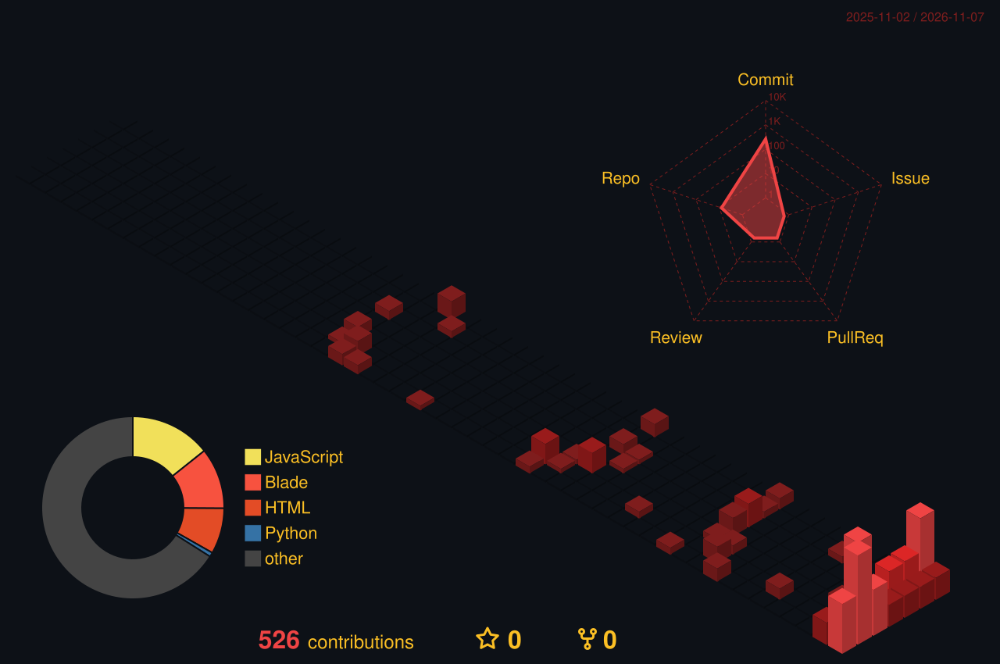
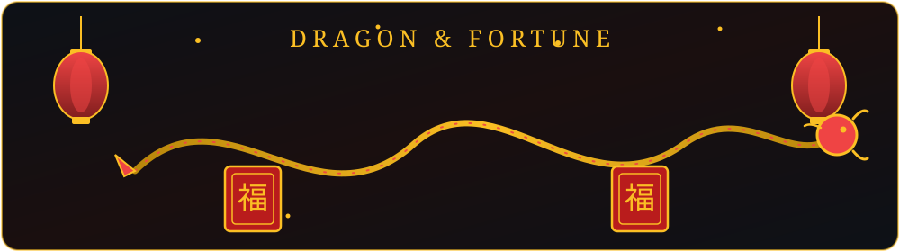

# Hi, I'm Aung Zay Ya Naing - Thomas

**Portfolio: https://aung-zay-ya-naing.vercel.app/**

Aung Zay Ya Naing, also known as Thomas / Thomas Ryson, is an entrepreneur from Myanmar. Creating digital opportunities for Myanmar. He is the founder of Digital Product Myanmar, where he sells AI tools, VPN, streaming and software subscriptions.

---

## About Me

- Started in Online Business in 2024.
- Mission: create digital opportunities for Myanmar youth, with trusted services and quality products.
- Opportunity is not waited for, it is created - test, fail, fix, test again.
- Personality: ENTP, Aries.
- Interests: psychological thrillers (Dexter, YOU, The Mentalist), understanding human psychology, and lifelong learning in AI tools, marketing, and human behaviour.

> "Nothing is impossible."

---

## What I Do

- Digital Product Seller - AI tools, VPN, streaming, software and subscriptions at a fair price with full warranty. Prices are in Myanmar kyat; orders are completed through Telegram.
- Course Tutor - practical, easy-to-understand courses.
- CV Form Service - professional CVs that raise job chances.
- Collaboration - open to collaborate with brands, projects, and businesses.

---

## Skills

      

- Digital Marketing
- AI Tools and Automation
- Content Creation
- Community Building
- E-Commerce and Online Selling
- Telegram Bots and Communities
- Teaching
- Business Strategy

---

## Experience

- 2024-present: Founder & CEO, Digital Product Myanmar - AI tools, VPN, streaming, software and subscriptions sold with trusted service.
- 2024-present: Founder, The Entrepreneur Hub - daily business knowledge community (10 posts a day).
- 2025-present: Founder, WFH Network Myanmar - online jobs for youth and a professional CV service.
- 2024-present: Course Tutor, Thomas Online Business Centre - practical teaching for many people.
- 2026-present: Founder, MinNwe AI - his own AI SaaS platform, built and launched.

---

## Digital Product Myanmar

Digital Product Myanmar is the shop Ellis runs. It sells AI tools, VPN, streaming and software subscriptions in Myanmar, with prices in Myanmar kyat.

**What the shop sells:**

- AI tools: ChatGPT, Gemini, Claude AI, Grok, Perplexity, Leonardo, Midjourney
- VPN: Express VPN, NordVPN, Surfshark VPN
- Streaming and music: Netflix, YouTube Premium, Spotify, Apple Music
- PC software: Microsoft 365, Windows 11 Pro, IDM
- Design tools: Canva Pro, Figma Pro
- Editing apps: CapCut Pro, KineMaster Pro, Alight Motion
- Storage and cloud: Google One, iCloud+, OneDrive
- Education and reading: Duolingo, Coursera, Kindle Unlimited, Scribd
- Adobe: Creative Cloud, Photoshop, Illustrator, Premiere Pro, After Effects
- Social and communication: Telegram Premium, Facebook Star, TikTok Coin, WhatsApp Business
- Payment accounts: PayPal, Wise, Payoneer, WebMoney

**Shop sites:** [Thomas Digital Shop](https://thomasdigitalshop.vercel.app/) · [Digital Product Myanmar](https://digital-product-myanmar-v2.vercel.app/) · [Resellers site](https://thomasdigitalshopresellerwebsite.vercel.app)

**How ordering works:** choose a product and plan on the shop site and see the total in kyat. On Thomas Digital Shop, pay by KBZPay or WavePay, then send the order receipt to the admin on Telegram ([@Thomas_Shops](https://t.me/Thomas_Shops)) to complete the order. The Digital Product Myanmar site also lists AYA Pay, and live chat from 7:00 AM to 11:00 PM daily.

---

## My Ventures / Projects

- Digital Product Myanmar - AI tools, VPN, streaming, software and subscriptions with trusted service.
- MinNwe AI - his own AI SaaS platform, built and launched in 2026.
- WFH Network Myanmar - online jobs for youth and a professional CV service.
- The Entrepreneur Hub - daily business knowledge community.
- The Quiet Zone Library - a library for book lovers, started in October 2024.
- AungZayYaNaing — Insights - a blog with long-form articles on tech and digital content.
- LinkedIn Basic Starter Course - a LinkedIn course.
- FocusTeenagersAcademy - courses for teenagers.

---

## Featured Projects on GitHub

I build web shops and tools for Myanmar. If you like what I build, a star on a project helps it reach more people.

- [KyatScope](https://github.com/aungzayyanaing/kyatscope) — Myanmar kyat (MMK) exchange rates for 103 currencies: market and bank rates, a converter and charts, plus live crypto and US stocks. ([Live demo](https://kyatscope.vercel.app))
- [laravel-task-board](https://github.com/aungzayyanaing/laravel-task-board) — Add tasks and move them between To do, Doing and Done. Laravel 13, PHP 8.3, SQLite and plain CSS, with no accounts and no JavaScript build step.
- [Thomas Digital Shop](https://github.com/aungzayyanaing/Thomas-Digital-Shop) — Single-page storefront for Digital Product Myanmar: digital subscriptions, AI tools and software, with prices in Myanmar kyat and orders completed through Telegram. ([Live site](https://thomasdigitalshop.vercel.app/))
- [Thomas Digital Shop Resellers Website](https://github.com/aungzayyanaing/Thomas-Digital-Shop-Resellers-Website) — Reseller website for Thomas Digital Shop, with the same catalog, prices in kyat and a cart; orders are completed through Telegram. ([Live site](https://thomasdigitalshopresellerwebsite.vercel.app))
- [snake-game](https://github.com/aungzayyanaing/snake-game) — Snake Apple game in Python with tkinter.
- [rock-paper-scissors](https://github.com/aungzayyanaing/rock-paper-scissors) — Play Rock Paper Scissors against the computer — best of 5 rounds — in plain HTML, CSS and JavaScript.
- [daily-log](https://github.com/aungzayyanaing/daily-log) — A plain Markdown daily log, updated automatically by a GitHub Actions workflow.

---

## GitHub Stats

---

## Contribution Snake

---

## 3D Contributions

---

## Dragon & Fortune

---

## Connect

- Portfolio: https://aung-zay-ya-naing.vercel.app/
- Facebook: https://www.facebook.com/share/1AWfFQ7VFk/
- YouTube: https://www.youtube.com/@AungZayYaNaing2
- Threads: https://www.threads.com/@aungzayyanaing_2
- LinkedIn: https://www.linkedin.com/in/aung-zay-ya-naing-0016b33a7
- GitHub: https://github.com/aungzayyanaing
- Telegram: https://t.me/Thomaswayne2
- Instagram: https://www.instagram.com/aungzayyanaing_2
- Discord: aung_zay_ya_naing
- WhatsApp: https://wa.me/959650023587
- Phone: +95 9650023587
- Email: aungzayyanaing2@gmail.com
- Digital Product Myanmar: https://digital-product-myanmar-v2.vercel.app/
- Thomas Digital Shop: https://thomasdigitalshop.vercel.app/
- Telegram (shop orders): https://t.me/Thomas_Shops

